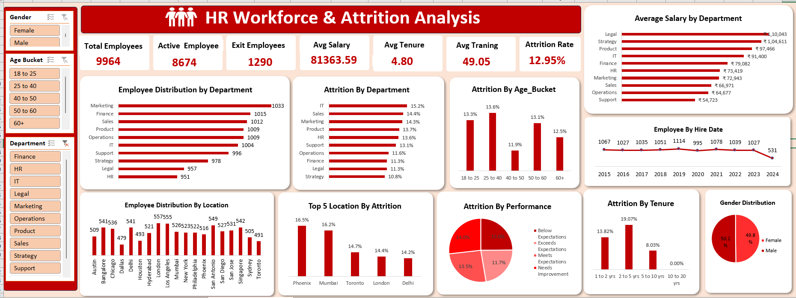

# 📊 HR Workforce Analytics – Employee Attrition & Performance

Excel-based HR analytics project to analyze workforce structure, employee attrition, demographics, compensation, performance, tenure, and HR insights.

---

## 📑 Table of Contents

- [Overview](#-overview)
- [Business Problem](#-business-problem)
- [Project Objectives](#-project-objectives)
- [Dataset](#-dataset)
- [Tools & Technologies](#️-tools--technologies)
- [Project Structure](#-project-structure)
- [Data Cleaning & Preparation](#-data-cleaning--preparation)
- [Exploratory Data Analysis](#-exploratory-data-analysis)
- [HR Analytics](#-hr-analytics)
- [Research Questions & Key Findings](#-research-questions--key-findings)
- [Dashboard](#-dashboard)
- [Business Recommendations](#-business-recommendations)
- [How to Run](#️-how-to-run)
- [Project Report](#-project-report)
- [Limitations](#️-limitations)
- [Future Improvements](#-future-improvements)
- [Project Highlights](#-project-highlights)
- [Author](#-author)

---

## 🔎 Overview

This project analyzes **9,964 employee records** using Microsoft Excel to understand workforce composition, employee attrition, demographics, salary patterns, tenure, performance, employment type, job roles, and location-level workforce trends.

The project demonstrates an end-to-end **HR Workforce Analytics** workflow using Excel for data preparation, analysis, visualization, and dashboard reporting.

The analysis focuses on identifying employee segments with higher attrition and generating actionable insights that can support HR retention and workforce planning decisions.

---

## 🎯 Business Problem

Employee attrition can increase recruitment costs, reduce productivity, and create workforce instability.

This project addresses the following HR business problems:

- Which departments have the highest employee attrition?
- Which tenure groups are more likely to leave?
- Does attrition vary across age groups?
- Which locations have higher attrition?
- Does performance rating relate to employee attrition?
- How does attrition differ by gender and employment type?
- Which departments have the highest average salary?
- Which job roles require further HR investigation?

---

## 🎯 Project Objectives

The main objectives of this project are:

1. Analyze overall workforce size and employee status.
2. Calculate the overall employee attrition rate.
3. Identify high-attrition departments.
4. Analyze attrition by age and tenure.
5. Compare attrition across different locations.
6. Analyze attrition by gender and employment type.
7. Analyze the relationship between performance rating and attrition.
8. Compare average salaries across departments.
9. Identify job roles with elevated attrition.
10. Create an Excel-based HR dashboard for management reporting.

---

## 📂 Dataset

The project uses the supplied HR Workforce Excel dataset.

### Dataset Summary

| Metric                 | Value       |
|------------------------|-------------|
| Total Employees        | 9,964       |
| Active Employees       | 8,674       |
| Employees Exited       | 1,290       |
| Overall Attrition Rate | 12.95%      |
| Average Age            | 43.4 Years  |
| Average Salary         | $81,364     |
| Average Tenure         | 4.8 Years   |
| Average Training Hours | 49.1 Hours  |

### Important Columns

The main `HR_Data` sheet contains:

- `Employee_ID`
- `Full_Name`
- `Gender`
- `Age`
- `Department`
- `Employment_Type`
- `Job_Title`
- `Location`
- `Hire_Date`
- `Exit_Date`
- `Years_of_Service`
- `Annual_Salary`
- `Bonus_Percentage`
- `Performance_Rating`
- `Training_Hours_Last_Year`
- `Attrition`
- `Reports_To_Manager_ID`
- `Age Bucket`
- `Tenure Bucket`
- `AttritionFlag`

> **Note:** The supplied workbook is an extended/customized HR workforce dataset containing 9,964 employee records.

---

## 🛠️ Tools & Technologies

### Excel
- Microsoft Excel
- Advanced Excel
- Excel Formulas
- Power Query
- PivotTables
- PivotCharts
- Conditional Formatting
- Slicers & Filters
- Lookup Functions
- KPI Calculations
- Data Visualization

### Analytics Skills
- HR Analytics
- Workforce Analytics
- Attrition Analysis
- Employee Segmentation
- Compensation Analysis
- Performance Analysis
- Business Intelligence
- Dashboard Development

---

## 📁 Project Structure

```text
HR-Workforce-Analytics-Excel/
│
├── README.md
│
│
├── Image/
│    └──HR_Analysis_Workfore.xlsx
│
├── dashboard/
│   └── HR_Dashboard.png
│
└── docs/
    └── HR_Workforce_Analytics_Project_Report.docx
```

---

## 🧹 Data Cleaning & Preparation

The following data preparation steps were performed in Excel:

- Reviewed workbook structure and data fields.
- Checked employee record completeness.
- Validated employee IDs.
- Reviewed missing values.
- Created and used `AttritionFlag` for numerical analysis.
- Created age-based employee segments.
- Created tenure-based employee segments.
- Prepared department-level summaries.
- Prepared location-level summaries.
- Prepared performance-level summaries.
- Prepared salary analysis.
- Prepared job-title analysis.

### Attrition Flag

```text
Attrition = Yes → AttritionFlag = 1
Attrition = No  → AttritionFlag = 0
```

### Attrition Rate Formula

```text
Attrition Rate = SUM(AttritionFlag) / COUNT(Employee_ID)
```

---

## 📊 Exploratory Data Analysis

The exploratory analysis focuses on understanding workforce structure and identifying employee segments with different attrition patterns.

### Analysis Areas

- Workforce Headcount
- Employee Attrition
- Department
- Age
- Tenure
- Gender
- Employment Type
- Location
- Performance Rating
- Job Title
- Annual Salary
- Training Hours

---

## 📈 HR Analytics

### 1. Workforce KPI Analysis

| KPI                    | Result     |
|------------------------|------------|
| Total Employees        | 9,964      |
| Active Employees       | 8,674      |
| Employees Exited       | 1,290      |
| Attrition Rate         | 12.95%     |
| Average Age            | 43.4       |
| Average Salary         | $81,364    |
| Average Tenure         | 4.8 Years  |
| Average Training Hours | 49.1       |

### 2. Attrition by Department

Department-level analysis identifies areas with comparatively high employee turnover.

| Department | Attrition Rate |
|------------|----------------|
| IT         | 15.2%          |
| Sales      | 14.4%          |
| Marketing  | 14.3%          |
| Product    | 13.7%          |
| HR         | 13.6%          |
| Support    | 13.1%          |
| Operations | 11.6%          |
| Finance    | 11.3%          |
| Legal      | 11.3%          |
| Strategy   | 10.8%          |

**Key Insight:**  
IT has the highest department-level attrition rate at **15.2%**.  
IT, Sales, and Marketing should be investigated further by combining Job Title, Tenure, Location, Salary, Performance, and Employment Type.

### 3. Attrition by Tenure

| Tenure Group | Attrition Rate |
|--------------|----------------|
| 1–2 Years    | 13.8%          |
| 2–5 Years    | 19.1%          |
| 5–10 Years   | 8.0%           |
| 10–20 Years  | 0.0%           |

**Key Insight:**  
The **2–5 year** tenure group has the highest attrition rate at **19.1%**.  
This makes the 2–5 year employee segment an important retention priority.

Potential areas to investigate:
- Career progression
- Promotion opportunities
- Salary growth
- Training
- Employee engagement
- Manager support
- Workload

> Note: The 10–20 year group contains a small number of employees, so the 0% attrition rate should not be generalized.

### 4. Attrition by Age

| Age Group | Observation        |
|-----------|--------------------|
| 18–25     | Higher attrition   |
| 25–40     | Highest attrition  |
| 40–50     | Lower attrition    |
| 50–60     | Moderate attrition |
| 60+       | Higher attrition   |

**Key Insight:**  
The **25–40** age group has the highest observed attrition.  
This group can be further analyzed based on Career growth, Salary, Job role, Tenure, Location, and Performance.

### 5. Attrition by Location

Location analysis helps identify geographical workforce risk.

**Key Finding:**  
**Phoenix** has the highest observed location-level attrition at **16.5%**.

Other high-attrition locations (Top 5):

| Location  | Attrition Rate |
|-----------|----------------|
| Phoenix   | 16.5%          |
| Mumbai    | 16.2%          |
| Toronto   | 14.7%          |
| London    | 14.4%          |
| Delhi     | 14.2%          |

### 6. Attrition by Performance Rating

**Key Finding:**  
Employees classified as **Needs Improvement** show the highest observed attrition rate.

This can support further investigation into:
- Performance coaching
- Training
- Career development
- Manager support
- Employee engagement

> This is an observed association and does not prove that performance rating directly causes employee attrition.

### 7. Compensation Analysis

Average annual salary was compared across departments.

**Key Findings:**
- **Legal** has the highest average department salary.
- **Strategy** also has a relatively high average salary.
- **Support** has the lowest average department salary.

Salary analysis should be combined with Job Title, Experience, Tenure, Performance, and Location to better understand compensation and retention patterns.

### 8. Job Title Analysis

Job titles were analyzed to identify roles with elevated attrition.

Roles requiring further investigation:
- Sales Executive
- Digital Marketing Specialist
- Other high-volume roles with elevated attrition

Potential areas for investigation include Workload, Career progression, Compensation, Incentives, Manager support, and Job satisfaction.

---

## 🔬 Research Questions & Key Findings

| # | Research Question                              | Finding                          |
|---|------------------------------------------------|----------------------------------|
| 1 | What is the overall attrition rate?            | **12.95%** (1,290 / 9,964)       |
| 2 | Which department has the highest attrition?    | **IT — 15.2%**                   |
| 3 | Which tenure group is most vulnerable?         | **2–5 Years — 19.1%**            |
| 4 | Which age group has the highest attrition?     | **25–40 Years**                  |
| 5 | Does employment type strongly affect attrition?| Differences are relatively small |
| 6 | Which performance group has the highest attrition? | **Needs Improvement**        |
| 7 | Which location has the highest attrition?      | **Phoenix — 16.5%**              |

---

## 📊 Dashboard

The Excel dashboard provides an executive-level view of workforce performance and employee attrition.

### Dashboard KPIs
- Total Employees
- Active Employees
- Employees Exited
- Attrition Rate
- Average Salary
- Average Tenure
- Average Training Hours

### Dashboard Visuals
- Attrition by Department (Highest → Lowest)
- Attrition by Tenure
- Attrition by Age
- Top 5 Locations by Attrition
- Performance vs Attrition
- Average Salary by Department
- Employee Distribution by Department & Location
- Gender Distribution

### Recommended Slicers
- Department
- Gender
- Employment Type
- Location
- Performance Rating
- Age Bucket
- Tenure Bucket

### Dashboard Preview



---

## 💡 Business Recommendations

### 1. Focus on 2–5 Year Employees
The 2–5 year group has the highest attrition.  
HR should review:
- Promotion opportunities
- Salary progression
- Career development
- Training
- Manager relationships
- Employee engagement

### 2. Investigate High-Attrition Departments
Prioritize:
- **IT**
- **Sales**
- **Marketing**

Analyze department attrition by job title, tenure, location, and performance.

### 3. Investigate High-Attrition Locations
Phoenix and other high-attrition locations should be compared with lower-attrition locations.

### 4. Strengthen Career Development
HR can introduce:
- Structured career paths
- Mentoring programs
- Internal mobility
- Training programs
- Promotion frameworks

### 5. Combine Performance and Retention Monitoring
Performance analysis should be combined with coaching, training, manager support, employee engagement, and retention discussions.

### 6. Develop an HR Early-Warning Dashboard
Future HR reporting can monitor:
- Attrition Rate
- Department Attrition
- Tenure Risk
- Salary Bands
- Performance
- Location
- Promotion History
- Employee Engagement
- Exit Reasons

---

## ▶️ How to Run

### Step 1 — Clone the Repository

```bash
git clone https://github.com/sumita-das11/hr-workforce-analytics-excel.git
```

### Step 2 — Open the Excel Workbook

```text
HR_Analysis_Workfore.xlsx
```

### Step 3 — Explore the Worksheets

```text
HR_Data
Attrition Analysis
Workforce Demographics
HR Analysis Dashbord
```

### Step 4 — Review the Dashboard

Open the dashboard sheet and use the available filters/slicers to explore workforce patterns.

---

## 📄 Project Report

A detailed Word project report is included with the project:

```text
HR_Workforce_Analytics_Project_Report.docx
```

The report contains:
- Executive Summary
- Dataset Analysis
- Data Preparation
- Workforce KPI Analysis
- Attrition Analysis
- Department Analysis
- Tenure Analysis
- Age Analysis
- Location Analysis
- Performance Analysis
- Compensation Analysis
- Job Title Analysis
- Key Findings
- HR Recommendations
- Dashboard Design
- Limitations
- Conclusion

---

## ⚠️ Limitations

This project is primarily descriptive and identifies patterns and associations.

The dataset does not contain detailed information about:
- Employee satisfaction
- Employee engagement
- Exit interview reasons
- Manager effectiveness
- Promotion history
- Work-life balance survey results
- Benefits satisfaction

Therefore, the identified relationships should be treated as **areas for HR investigation** rather than proven causes of attrition.

---

## 🚀 Future Improvements

Future versions of this project can include:

- Monthly attrition trend analysis
- Employee attrition prediction
- Machine Learning-based risk scoring
- Salary-band analysis
- Employee satisfaction analysis
- Exit reason analysis
- Manager-level attrition analysis
- Promotion and career-growth analysis
- Power BI dashboard
- Automated HR reporting

---

## 🏆 Project Highlights

- 📊 9,964 Employee Records
- 📉 12.95% Overall Attrition
- 👥 Workforce Analytics
- 📈 Employee Attrition Analysis
- ⏳ Tenure Analysis
- 🎂 Age Analysis
- 📍 Location Analysis
- ⭐ Performance Analysis
- 💰 Compensation Analysis
- 👔 Job Title Analysis
- 📊 Excel Dashboard
- 🔎 PivotTable & PivotChart Analysis
- 🧹 Data Cleaning & Preparation
- 💼 HR Business Insights

---

## 👩‍💻 Author

**Sumita Das**  
Data Analyst | Excel | SQL | Python | Power BI

**Connect With Me**
- GitHub: [github.com/sumita-das11](https://github.com/sumita-das11)
- LinkedIn: [linkedin.com/in/sumitadas](https://linkedin.com/in/sumitadas)
- Email: dassumita647@gmail.com
